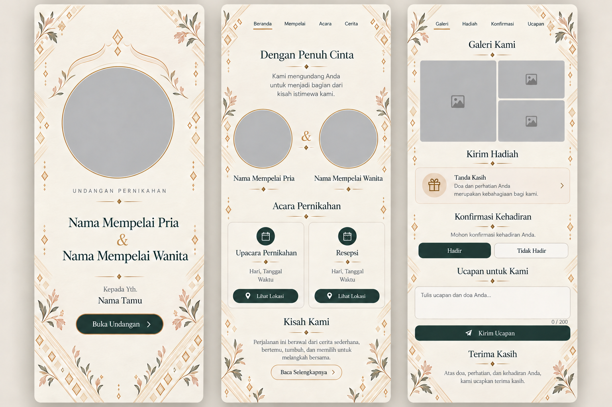
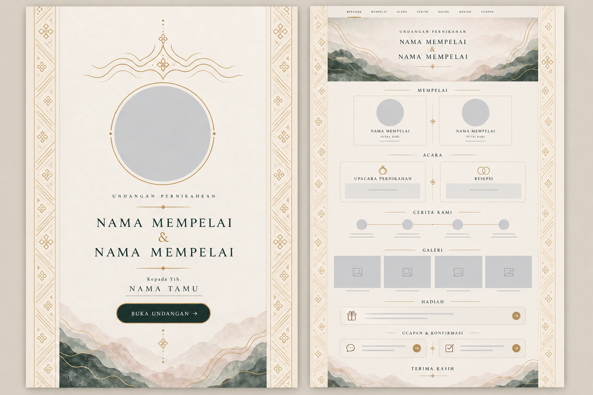

# Siger Priangan Atelier — T1 visual board

**Review status:** concept direction for the approved [Siger Priangan template](../superpowers/specs/2026-10-29-siger-priangan-premium-template-design.md). This board is not a published theme, a production asset manifest, or a claim that the exploratory siger contour is an accurate ceremonial rendering. The product name remains **Siger Priangan**; *Atelier* names the visual concept only.

## Full guest flow previews

The HTML boards are the precise static compositions. Their names, dates, section labels, buttons, and form labels are real text, separate from the generated artwork. The PNG studies communicate visual rhythm; any text inside a generated PNG is illustrative and must not be copied into product data.

| View | Precise static composition | Visual mood study |
| --- | --- | --- |
| Mobile, three 390 px artboards | [mobile-flow.html](../../assets/themes/siger-priangan/concepts/mobile-flow.html) | [mobile-composition-v2.png](../../assets/themes/siger-priangan/concepts/mobile-composition-v2.png) |
| Desktop, 1280 px canvas with 720 px reading column | [desktop-flow.html](../../assets/themes/siger-priangan/concepts/desktop-flow.html) | [desktop-composition-v2.png](../../assets/themes/siger-priangan/concepts/desktop-composition-v2.png) |

### Refinement from v1

The first raster compositions, [mobile v1](../../assets/themes/siger-priangan/concepts/mobile-composition-study.png) and [desktop v1](../../assets/themes/siger-priangan/concepts/desktop-composition-study.png), remain in the concept folder for comparison but are **superseded**. Their floral borders read as generic wedding decoration, and their event title used the religiously specific `Akad Nikah`, contrary to the owner's neutral-default decision. They are not recommended for implementation or presentation as the final direction.

V2 gives the cover's abstract siger-inspired relief a clearer central crest and two side wings while retaining the circular photo aperture. Original diagonal and diamond rhythms now carry the textile cue down side margins and across a few section transitions. Floral detail is smaller and less dominant. The first event label is the neutral `Upacara Pernikahan`, and the mobile RSVP concept shows only `Hadir` and `Tidak Hadir`. These changes make the craft direction more legible without putting ornament under names, controls, or event details. The crest is still a design hypothesis pending practitioner review.

The flow in both HTML boards is: opening cover → hero → couple and editable greeting → events and location → story → gallery → gifts → RSVP/wishes → closing. Empty optional sections disappear. The opening view includes the guest addressee; RSVP in a preview is visibly read-only. Event names are owner-editable; the board uses `Upacara Pernikahan` as a neutral example, not a built-in religious event type. The board uses illustrative names and a future sample date only, never a customer invitation.

## Visual grammar

| Element | Direction | Implementation boundary |
| --- | --- | --- |
| Cover | Warm ivory cotton paper with blind emboss and a quiet seal; centered portrait aperture and names | Photo, names, date, addressee, and button are independent DOM layers |
| Siger cue | An original **contour interpretation**, lightly embossed near the portrait, not a photographed or traced headpiece | Current raster contour is provisional and must be reviewed by a Priangan bridal practitioner before runtime art |
| Garutan cue | Fine diagonal and diamond rhythm with tiny flora in the far margins | Original geometry only; no copied artisan pattern, no claim that one sample motif represents every Garutan tradition |
| Portrait mat | Thin gold rule, inner ivory separation, restrained shadow | Actual owner-supplied photo; no AI-generated couple portrait |
| Section continuity | Paper tone and line rhythm continue across sections; transition edges feel like overlapping stationery leaves | Avoid full-width decorative PNG panels that create hard horizontal seams |
| Color | Ivory `#F6F1E8`, ink green `#243B35`, antique gold `#B58B53`, earth blush `#C8A69A` | Ink green on ivory is about **10.65:1**; gold on ivory about **2.75:1**, so gold is for ornaments and rules, not small text |
| Typography | Moderate-contrast serif for couple names/headings; readable humanist sans for dates, addresses, forms, and actions | Use proper web font subsets later; no decorative Latin script for body copy and no Sundanese script without linguistic review |

The cover and ornament material studies are saved as [cover-material-study.png](../../assets/themes/siger-priangan/concepts/cover-material-study.png) and [ornament-layer-study.png](../../assets/themes/siger-priangan/concepts/ornament-layer-study.png). The ornament PNG has true transparency but is visually too dense and large for a runtime overlay. Both remain **concept studies**. Rebuild final details as independent, smaller SVG/CSS and optimized raster layers after cultural review; do not drop either full image behind interactive content.

## Layout and safe areas

- **Mobile 360–430 px:** one reading column. Keep at least 20–24 px lateral padding for text and controls. Portrait is about 180 px in the 390 px cover study, with the CTA in its own quiet lower zone. Place decoration only outside the text and control footprint, and crop it at the section edge rather than allowing horizontal overflow.
- **Tablet 768 px:** preserve the reading hierarchy and increase surrounding air. Event and profile cards may become paired only when each retains a readable width; never force tiny two-column controls.
- **Desktop 1280–1440 px:** keep the main reading measure around 640–760 px (720 px in this board). Use the side fields for low-contrast art and paper depth. The cover stays a centered keepsake object rather than becoming a giant full-width card.
- **Long content:** names wrap, story chapters expand, gallery captions add height, and event addresses remain selectable. Ornament must never be positioned against fixed content heights.
- **Interaction:** all button and link text is HTML. The final implementation needs clear focus rings and approximately 44 px touch targets. The sample board intentionally renders the visual static state, not functional form submission.

## Section transition frames and 3D direction

Each section has a stable final frame that reads correctly with no animation. For normal motion, only decorative layers and container surfaces gain shallow depth. Scroll remains directly controlled by the guest.

| Moment | Static frame | Optional motion cue |
| --- | --- | --- |
| Open cover → hero | Cover and first invitation page are individually complete | Seal fades; cover sheet turns a few degrees and clears, with no delayed CTA |
| Hero → couple | Portrait and names anchor the page | Portrait mat shifts 8–12 px relative to paper edge; text stays fixed |
| Couple → events | Two profiles settle into reading order | Cards separate slightly in depth; each remains in DOM order |
| Events → story | Date and location cards fully readable | Outer card shadow and edge move gently, no moving time/address text |
| Story → gallery | Story closes with a fine rule; gallery starts on the same paper canvas | A single paper edge crosses the boundary; no pinned sequence |
| Gallery → gifts | Images retain their final crop and captions | At most two image mats offset briefly; actual images do not distort |
| Gifts → RSVP | Financial text and form are stable | No 3D movement on account numbers, copy button, or fields |
| RSVP → closing | Thank-you remains visible | Small seal fade/settle only |

For the first implementation, use at most two or three independently transformed layers per section, `transform` and `opacity`, local section scroll progress, and no WebGL. Release animation work outside the viewport. On `prefers-reduced-motion: reduce`, render the static final frames immediately, preserving all content and actions. This follows the [WCAG animation guidance](https://www.w3.org/WAI/WCAG22/Understanding/animation-from-interactions) and [web.dev compositing advice](https://web.dev/articles/animations-guide).

## Artwork handoff for later stages

1. **Siger contour:** artist-drawn, culturally reviewed path; thin ivory emboss with a few gold catches. The current AI silhouette is a mood cue only, since it may read as a generic fantasy crown.
2. **Textile edge:** a small original repeatable geometric unit informed by Garutan diagonal/diamond characteristics, ideally SVG/CSS; do not trace a particular cloth.
3. **Floral accent:** two or three sparse botanical components, separately cropped for small and large viewports. The current generated cluster is too heavy for runtime use.
4. **Paper and portrait mat:** subtle seamless paper texture if CSS alone cannot achieve it; responsive photo mat as native layout, not baked into a single image.
5. **Transition frames:** separate paper edge and seal surfaces for cover, section change, and closing. No artwork should contain labels, names, dates, or controls.

Runtime raster derivatives, byte budgets, Cloudinary IDs, and a verified manifest belong to T4 after review. None of the six T1 PNGs is approved for direct runtime use.

## Cultural provenance and validation

The [Kemdikdasmen repository](https://repositori.kemendikdasmen.go.id/16254/) documents *tata rias pengantin Sunda siger* as bridal styling used for weddings and cultural performances. The [Garut government](https://www.garutkab.go.id/page/batik-tulis-garutan) describes Garutan batik through geometric diagonal/diamond forms, flora/fauna, and a cream color base. These sources justify a visual **reference direction**, not an exact contour, a symbolic meaning for each drawn line, or reproduction rights for an existing craft design.

Before any claim of cultural authenticity or launch, a Priangan bridal stylist or cultural practitioner should review the siger contour, whether its abstract use is respectful, the flora/diamond rhythm, and any ceremonial words. If Sundanese text is later introduced, verify spelling, register, meaning, and font shaping with a fluent reviewer. No religious formula is embedded by default. The couple's editable greeting and prayer may be empty.

## Provenance and limitations

- Six concept PNGs were generated with the built-in `image_gen` tool on 29–30 October 2026. The two v2 compositions used their v1 counterparts as edit references; no third-party input image was supplied. Exact prompts, including the targeted RSVP correction, are preserved in [prompts.md](../../assets/themes/siger-priangan/concepts/prompts.md).
- The HTML boards were authored for this project and reference the two material studies only as **visual concepts**. Their text and sequence are the source of truth for this design handoff.
- A generated desktop draft containing invented people and incorrect dates was rejected and not saved to this workspace. The recommended v2 composition PNGs use blank photo placeholders; final imagery must come from invitation owners.
- The in-app browser blocked local `file:` viewing under its URL policy, so the HTML boards were not browser-screen-captured in T1. Their section/text structure and referenced files are verified locally. This is a visual review limitation, not approval to use the PNGs as runtime assets.
- No production route, database record, Cloudinary object, price, or existing Classic Rose asset was changed.
