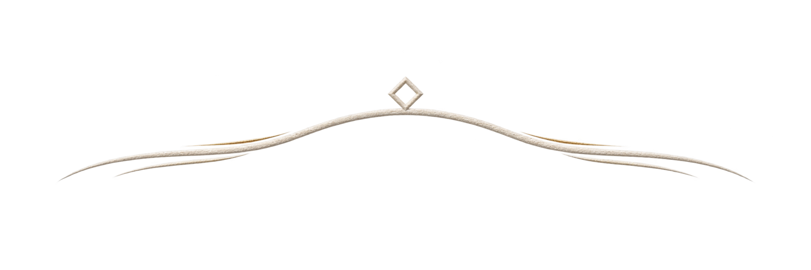
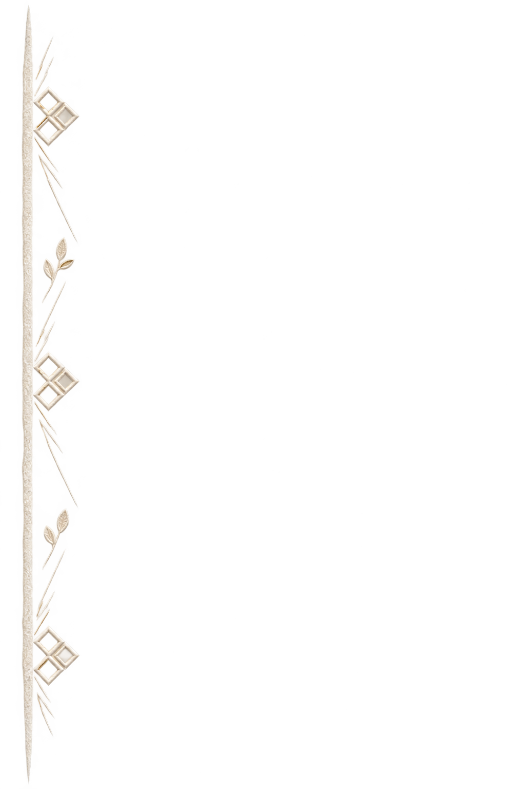

# Paket review budaya Siger Priangan

**Status 12 November 2026:** pemilik meminta desain dibuat lengkap terlebih dahulu, lalu ditinjau secara budaya. Semua gambar di bawah adalah konsep orisinal dan belum mendapat penilaian praktisi. Tidak satu pun sudah disetujui sebagai representasi tata rias adat atau diunggah ke Cloudinary. Pratinjau lokal kini memakai [foto ilustratif pasangan fiktif](siger-priangan-sample-media.md) untuk menunjukkan gerak antarbab; relief yang dirender tetap bentuk abstrak ringan. Status deployment publik dapat berbeda sampai kode ini diterbitkan.

Pada T5, kartu ketujuh di etalase tema memakai ilustrasi CSS/SVG dan menaut ke preview tersebut. Jalur uji lokal untuk menyimpan dan menerbitkan draf Siger tidak mengubah status budaya gambar ini. Konsep PNG tetap bahan sumber untuk review praktisi; tidak ada persetujuan untuk menjadikannya aset runtime, klaim keaslian budaya, atau aktivasi undangan pelanggan.

## Tujuan review

AyaWarta ingin membuat undangan pernikahan digital dengan arah Priangan umum dan aksen Garutan yang tertahan. Kami memerlukan penilaian dari penata rias pengantin Sunda atau praktisi budaya Priangan sebelum bentuk yang dapat terbaca sebagai atribut pengantin dipakai pada template premium. Penilaian ini menyangkut **kecocokan bentuk, penempatan, istilah, dan kesan keseluruhan**, bukan sertifikasi bahwa gambar ini menyalin siger tertentu.

## Bahan yang ditinjau

| Bahan | Fungsi yang diusulkan | Status dan hal yang perlu diamati |
| --- | --- | --- |
| [Alur mobile T1](../../assets/themes/siger-priangan/concepts/mobile-composition-v2.png) | Konteks cover dan urutan section | Studi suasana; teks di dalam gambar bukan konten produk. Kontur di atas lingkaran potret masih hipotesis. |
| [Kontur cover T4](../../assets/themes/siger-priangan/concepts/cover-contour-t4-study.png) | Tiga sapuan emboss terbuka di atas area potret | **Calon konsep**, bukan gambar siger historis. Lihat juga [prompt dan asal-usul](../../assets/themes/siger-priangan/concepts/cover-contour-t4-study.md). |
| [Tepi kertas T4](../../assets/themes/siger-priangan/concepts/paper-edge-layer-t4-study.png) | Lapisan kertas, dua ranting kecil, dan ritme belah ketupat di margin | **Calon konsep**; jangan dinilai sebagai motif batik Garutan tertentu. Lihat [prompt dan asal-usul](../../assets/themes/siger-priangan/concepts/paper-edge-layer-t4-study.md). |
| [Kontur cover v2](../../assets/themes/siger-priangan/concepts/cover-contour-t4-v2.png) | Sapuan relief terbuka dengan aksen belah ketupat kecil di atas slot potret | **Konsep sumber terbaru**; periksa jarak terhadap foto. [Prompt, ukuran, dan batas penggunaan](../../assets/themes/siger-priangan/concepts/t4-cultural-art-v2-provenance.md). |
| [Motif margin v2](../../assets/themes/siger-priangan/concepts/margin-motif-t4-v2.png) | Ritme diagonal, belah ketupat, ranting kecil, dan tepi kertas pada margin | **Konsep sumber terbaru**; abstraksi orisinal, bukan motif perajin tertentu. [Prompt dan asal-usul](../../assets/themes/siger-priangan/concepts/t4-cultural-art-v2-provenance.md). |
| [Visual board T1](siger-priangan-board.md) | Prinsip warna, ruang aman, dan transisi | Dokumen arah desain. Gambar ornamen T1 yang lebih padat tidak diusulkan sebagai aset runtime. |

## Pertanyaan untuk praktisi

1. Apakah tiga sapuan di atas potret terasa pantas dalam konteks undangan pernikahan Sunda, atau terlalu generik/berpotensi disangka atribut siger yang tidak tepat? Apakah penempatannya membuat potret pasangan seolah mengenakan atribut tertentu?
2. Dari sudut pandang Priangan umum dengan aksen Garutan, apakah ritme garis diagonal, belah ketupat terbuka, dan dua ranting kecil dapat dipakai sebagai **abstraksi dekoratif**? Bagian mana yang perlu dihapus atau diubah agar tidak menyerupai motif atau simbol dengan makna khusus?
3. Apakah nama produk **Siger Priangan** sesuai untuk pendekatan visual ini? Jika konsepnya terlalu abstrak untuk memakai kata *siger*, istilah atau arah apa yang lebih jujur?
4. Apakah ada unsur yang tidak patut dipakai lintas pasangan, keyakinan, atau variasi tata rias daerah? Tidak ada salam, doa, atau aksara Sunda bawaan dalam konten template.
5. Bila gambar ini direvisi, bentuk dan ruang kosong mana yang perlu dipertahankan agar foto, nama, tanggal, lokasi, dan tombol tetap jelas pada lebar ponsel 360–430 px?

## Cara mencatat hasil

Catat per bahan: **layak sebagai abstraksi / revisi / jangan gunakan**, alasan singkat, perubahan yang disarankan, serta nama atau peran reviewer dan tanggal review. Keputusan atas satu bahan tidak otomatis menyetujui bahan lain. Bila reviewer menyarankan bentuk baru, buat gambar orisinal baru; jangan menyalin foto atribut atau pola karya perajin tanpa izin yang sesuai.

## Dasar rujukan dan batasnya

- [Repositori Kemdikdasmen: *Tata rias pengantin Sunda siger*](https://repositori.kemendikdasmen.go.id/16254/) menempatkan siger dalam konteks rias pengantin dan pertunjukan; halaman ini tidak memvalidasi kontur konsep AyaWarta.
- [Kajian Departemen Pendidikan dan Kebudayaan tentang tata rias pengantin Jawa Barat](https://repositori.kemendikdasmen.go.id/27015/) membedakan Priangan, Cirebon, dan Kaleran. Pembahasan Sukapura dalam kajian itu menunjukkan bahwa makna dan penggunaan siger memiliki konteks setempat dan historis; jangan menyamaratakannya untuk semua tradisi Sunda.
- [Pemerintah Kabupaten Garut: Batik Tulis Garutan](https://www.garutkab.go.id/page/batik-tulis-garutan) menjelaskan kecenderungan geometri diagonal/belah ketupat dan unsur flora/fauna. Ini hanya rujukan arah visual; bukan izin untuk menyalin motif perajin atau menyebut abstraksi AyaWarta sebagai batik Garutan autentik.

## Rencana teknis setelah review

Konsep PNG **tidak boleh dilayani langsung**: kontur berukuran 805.080 byte dan tepi kertas 1.026.613 byte. Pengukuran encoding WebP lokal dari crop yang diusulkan memberi sekitar **5.982 byte (kontur 280 × 60)**, **11.768 byte (kontur 480 × 103)**, **11.202 byte (tepi 72 × 654)**, dan **34.008 byte (tepi 144 × 1309)**. Angka ini estimasi byte file, belum hasil pemeriksaan visual atau payload browser. Bentuk final, crop, dan ukurannya harus disesuaikan dengan masukan reviewer.

Setelah bentuk disetujui, simpan sumber orisinal di luar `public`, buat turunan sesuai slot, periksa alfa dan kualitas tepi pada latar ivory, lalu siapkan ID Cloudinary berbasis hash konten dan manifest URL berversi seperti pola Classic Rose. Unggah hanya setelah target, berkas, dan efek eksternalnya ditinjau secara terpisah. Pastikan gambar awal tidak membebani ponsel; lapisan di bawah cover dimuat sesuai kebutuhan. Tidak ada perubahan data pelanggan dalam paket review ini.
